<!-- ==================== HEADER SECTION ==================== -->

<h1 align="center">Terminal UI Player</h1>

  🎧 A collection of terminal-based music player UI concepts, themes, and layouts.

  This is where I showcase the different UI concepts, themes, and layouts I've created for my terminal-based music player. From compact dashboards and colorful interfaces to minimalist monochrome designs, each version offers a different look and approach to organizing music playback, playlists, lyrics, and real-time audio visualization.
   
  Feel free to explore and suggest the different designs and see how the project has evolved. More experiments and improvements coming soon!

---

<!-- ==================== PREVIEW GALLERY ==================== -->

## 🌟 Preview Gallery

The first design features a compact blue-themed dashboard, combining playback controls, playlists, and a real-time audio visualizer in one organized layout.

  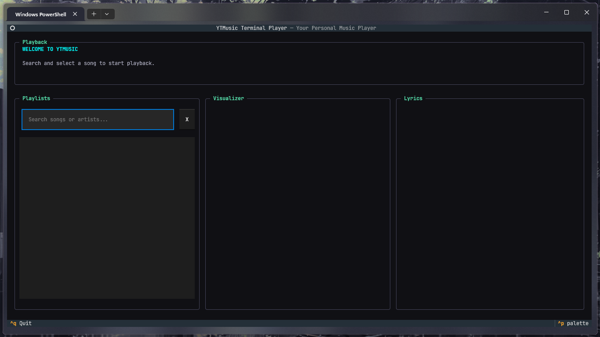
  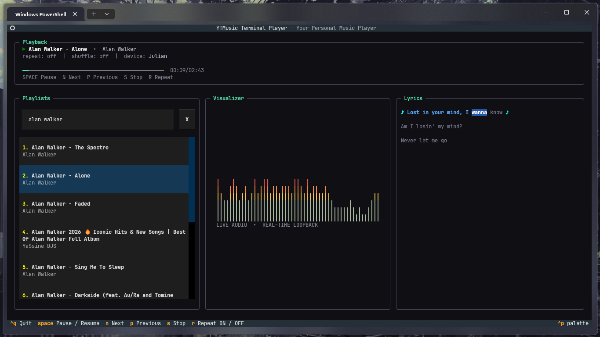

The second uses a dark purple theme with pink accents, featuring a dedicated search and playlist section, a spacious visualizer, and separate navigation for Lyrics and Queue.

  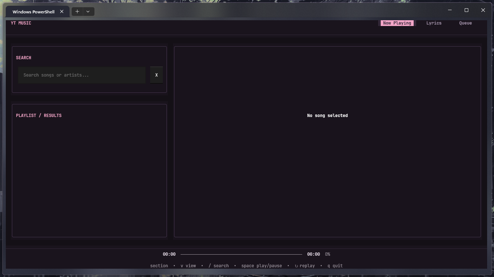
  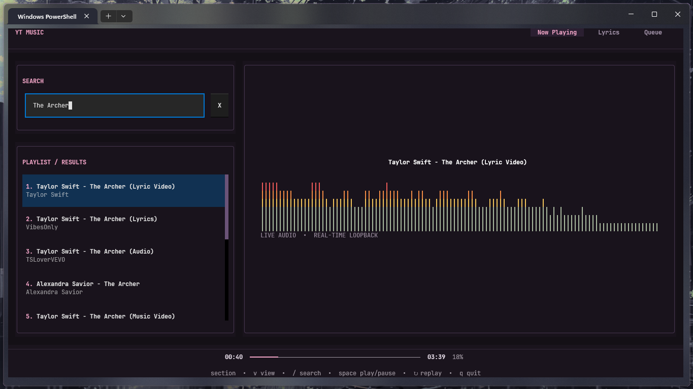
  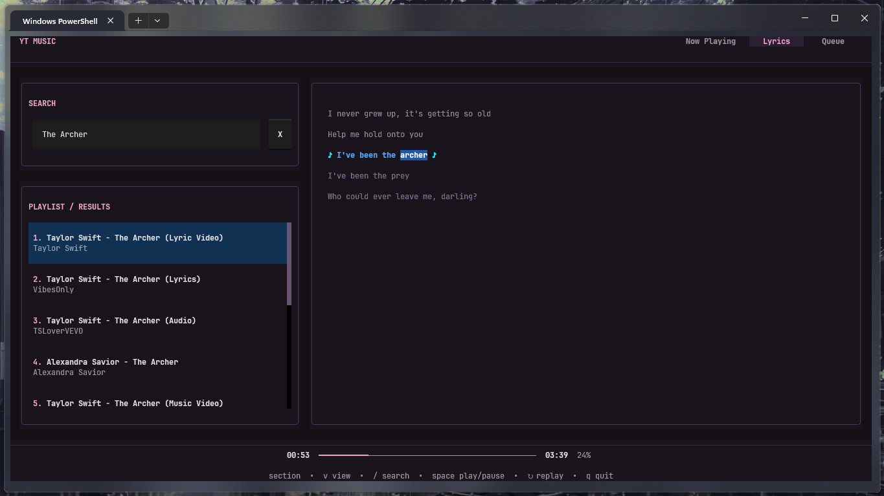
  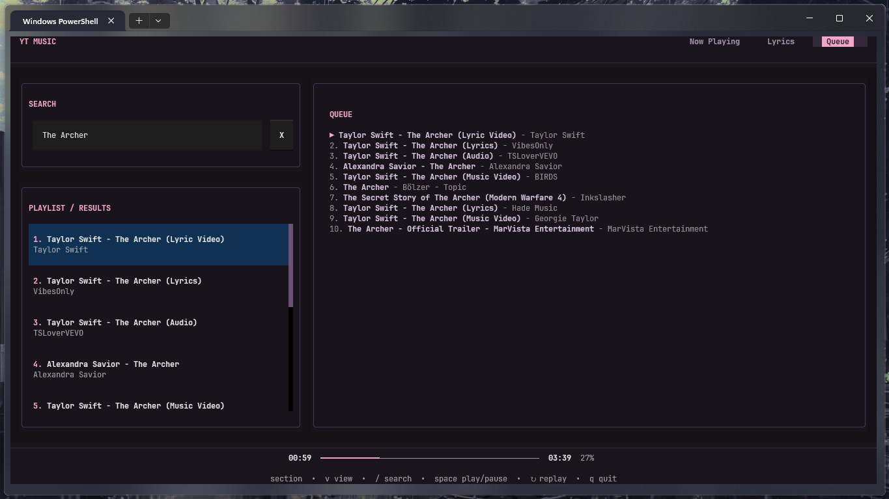

The third follows a minimalist monochrome style, using black, gray, and white with a simple sidebar for navigation and a wide central area focused on music visualization.

  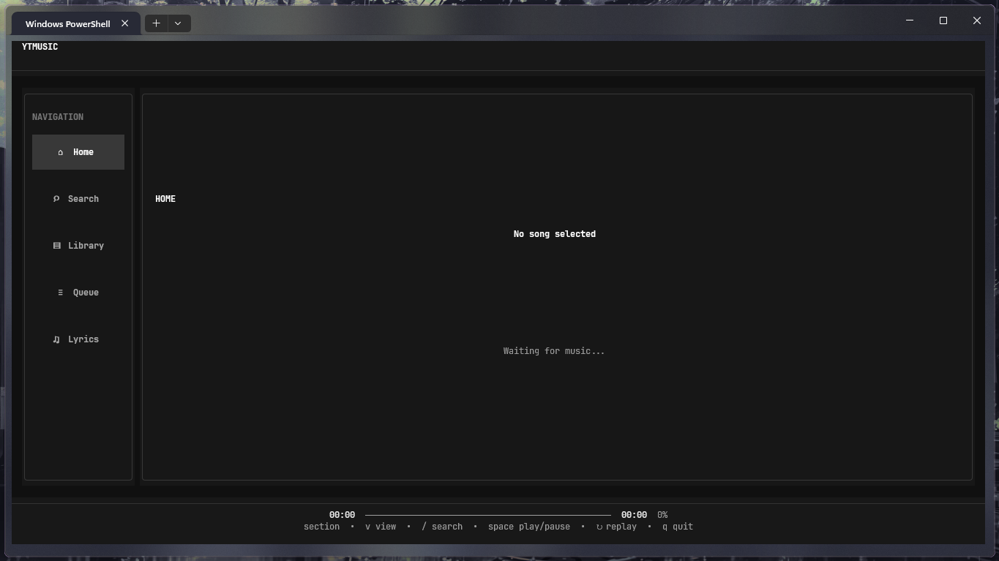
  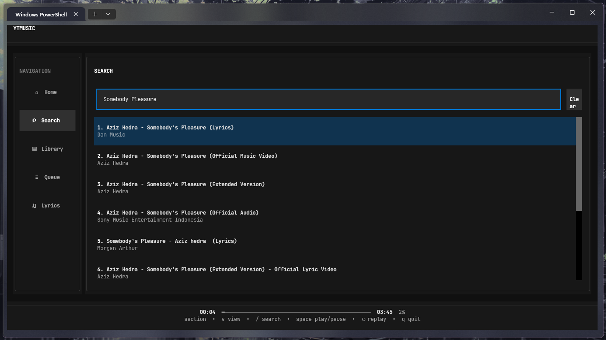
  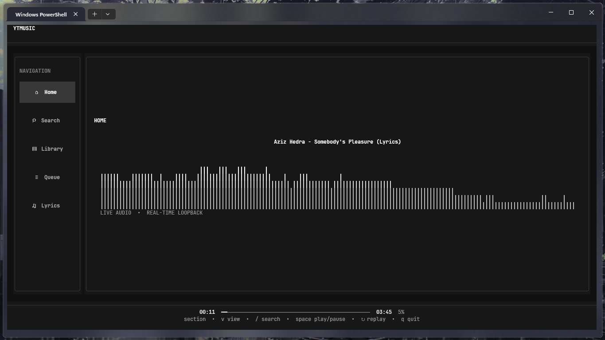
  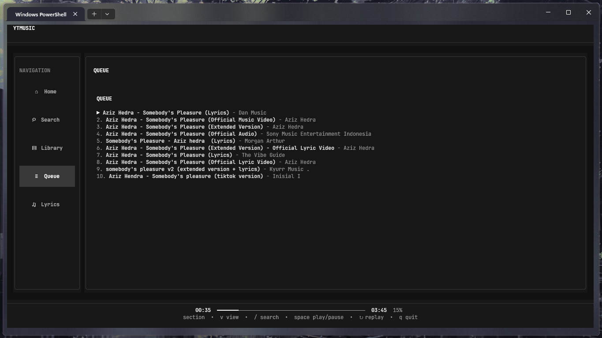
  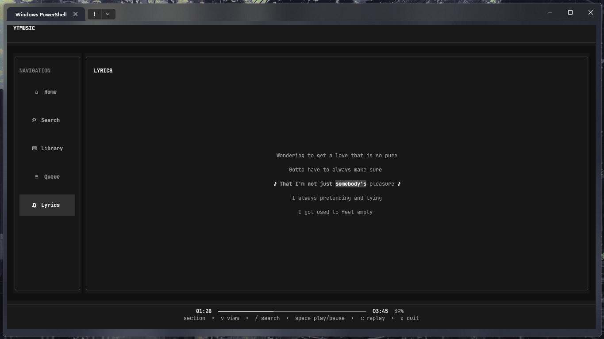

---

<!-- ==================== DEVELOPMENT NOTES ==================== -->

## 🛠️ Development Notes

I'm exploring different layouts, color palettes, and interface styles to see which direction works best for the project. Still experimenting haha.😅

---

  <i>Made with 🎧 while experimenting with terminal UI designs.</i>

